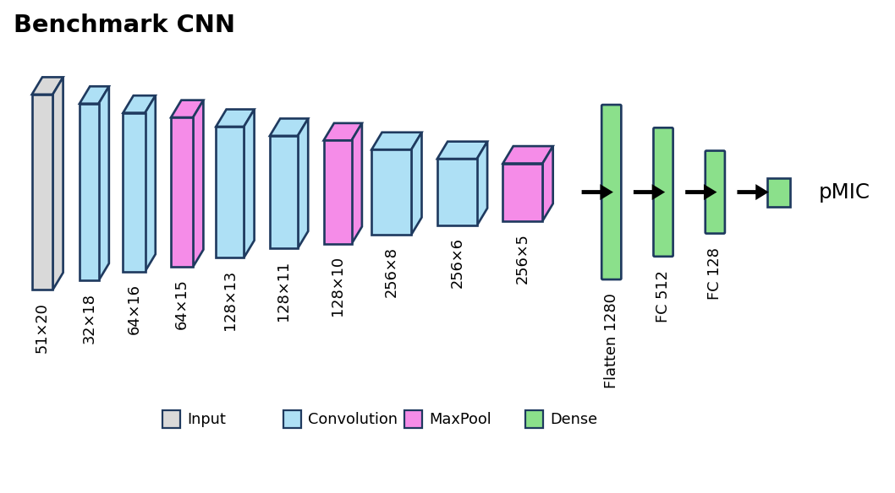
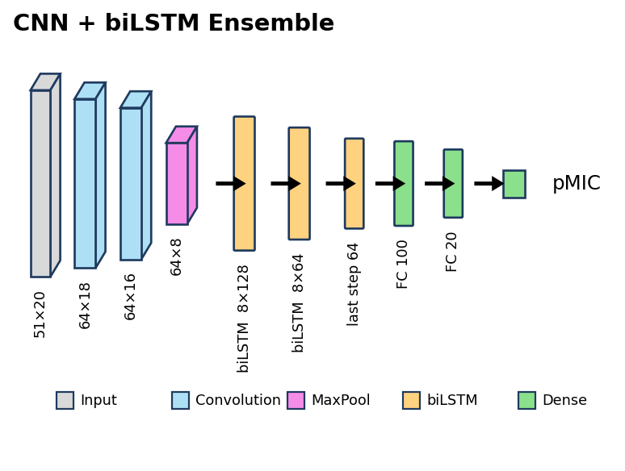

<a id="readme-top"></a>

[![License][license-shield]][license-url]
[![LinkedIn][linkedin-shield]][linkedin-url]

<br />
<div align="center">

<h1 align="center">Deep Learning Regression for Antimicrobial Peptide Potency Prediction</h1>

<p align="center">
  A CNN + biLSTM ensemble trained on peptide sequences to predict the Minimum Inhibitory Concentration (pMIC) against <em>E. coli</em>, deployed end-to-end on AWS SageMaker.
  <br /><br />
  <a href="https://github.com/DannyLCG/aws_udacity_capstone_project"><strong>Browse the code »</strong></a>
  &nbsp;·&nbsp;
  <a href="blog_post.md">Read the write-up</a>
</p>
</div>

---

<details>
  <summary>Table of Contents</summary>
  <ol>
    <li><a href="#overview">Overview</a></li>
    <li><a href="#results">Results</a></li>
    <li><a href="#architecture--approach">Architecture & Approach</a></li>
    <li><a href="#dataset">Dataset</a></li>
    <li><a href="#built-with">Built With</a></li>
    <li><a href="#getting-started">Getting Started</a></li>
    <li><a href="#key-takeaways">Key Takeaways</a></li>
    <li><a href="#contact">Contact</a></li>
    <li><a href="#acknowledgments">Acknowledgments</a></li>
  </ol>
</details>

---

## Overview

Antibiotic resistance causes over 700,000 deaths annually, driving urgent demand for alternatives. Antimicrobial peptides (AMPs) are a promising class of molecules that disrupt bacterial cell membranes with a lower risk of resistance development. While most ML approaches classify whether a peptide is antimicrobial, this project targets the harder problem: **predicting the exact potency** of an AMP sequence.

Given a raw peptide sequence, the model predicts its **pMIC** (negative log₁₀ of the Minimum Inhibitory Concentration) against *Escherichia coli* — a continuous value where smaller differences carry clinical weight due to the logarithmic scale. The full pipeline covers one-hot sequence encoding, custom dataset construction, SageMaker Hyperparameter Optimization, training with Debugger/Profiler monitoring, and real-time endpoint deployment.

This project was submitted as the capstone for the **Udacity AWS Machine Learning Engineer Nanodegree** (November 2024).

<p align="right">(<a href="#readme-top">back to top</a>)</p>

---

## Results

The ensemble model improved on the benchmark CNN across all four regression metrics. On a logarithmic target, the MAE gain from 0.607 → 0.534 and R² gain from 0.05 → 0.234 represent biologically meaningful improvements in predictive precision.

| Model | MAE | R² | MSE | RMSE |
|-------|-----|----|-----|------|
| Benchmark CNN | 0.607 | 0.050 | 0.572 | 0.756 |
| **Ensemble (CNN + biLSTM)** | **0.534** | **0.234** | **0.450** | **0.670** |

**Predicted vs. experimental mean pMIC on test set:**

| Source | Mean pMIC |
|--------|-----------|
| Experimental | 4.869 |
| Benchmark | 4.681 |
| **Ensemble** | **4.750** |

<p align="right">(<a href="#readme-top">back to top</a>)</p>

---

## Architecture & Approach

**Encoding:** Each peptide sequence is one-hot encoded into a 20×51 matrix (20 canonical amino acids × max length 50 + stop signal). Shorter sequences are zero-padded.

**Benchmark model:** Vanilla CNN with 6 convolutional blocks followed by 3 linear layers. Trained for 30 epochs as the baseline.



<details>
<summary>Layer-by-layer summary (output shapes as channels × length, PyTorch NCL convention)</summary>

| Layer | Type | Output shape | Params |
|-------|------|--------------|--------|
| conv1 | Conv1d | 32×18 | 4,928 |
| conv2 | Conv1d | 64×16 | 6,208 |
| pool1 | MaxPool1d | 64×15 | 0 |
| conv3 | Conv1d | 128×13 | 24,704 |
| conv4 | Conv1d | 128×11 | 49,280 |
| pool2 | MaxPool1d | 128×10 | 0 |
| conv5 | Conv1d | 256×8 | 98,560 |
| conv6 | Conv1d | 256×6 | 196,864 |
| pool3 | MaxPool1d | 256×5 | 0 |
| fc1 | Linear | 512 | 655,872 |
| fc2 | Linear | 128 | 65,664 |
| fc3 | Linear | 1 | 129 |
| **Total** | | | **1,102,209** |

</details>

**Ensemble model (main):**
- Two 1-D convolutional layers — capture local amino acid interactions
- Two bidirectional LSTM layers — capture long-range forward/backward dependencies
- Three fully connected linear layers — perform regression on pMIC



<details>
<summary>Layer-by-layer summary (output shapes as channels × length, PyTorch NCL convention)</summary>

| Layer | Type | Output shape | Params |
|-------|------|--------------|--------|
| conv1 | Conv1d | 64×18 | 9,856 |
| conv2 | Conv1d | 64×16 | 12,352 |
| bilstm1 | LSTM | 8×128 | 66,560 |
| bilstm2 | LSTM | 8×64 | 41,472 |
| fc1 | Linear | 100 | 6,500 |
| fc2 | Linear | 20 | 2,020 |
| fc3 | Linear | 1 | 21 |
| **Total** | | | **138,781** |

A `max_pool1d(kernel=2, stride=2)` between `conv2` and `bilstm1` halves the length (16 → 8) before the sequence is passed to the recurrent layers; `dropout` and the last-timestep slice are functional ops and omitted from the table.

</details>

**Hyperparameter Optimization:** 36 Bayesian HPO jobs on SageMaker (`ml.g4dn.xlarge`, ~6 min/job, ~3.6 hrs total). Tuned: epochs, learning rate, batch size. Best config: epochs=30, lr=0.01, batch=128.

**Training monitoring:** SageMaker Debugger rules (`vanishing_gradient`, `overtraining`, `loss_not_decreasing`) and Profiler confirmed no instability, overfitting, or compute bottlenecks.

<p align="right">(<a href="#readme-top">back to top</a>)</p>

---

## Dataset

- **Source:** [GRAMPA](https://grampa.ufsc.br/) — a curated collection of 6,760 unique AMP sequences with experimental MIC values from APD, DADP, DBAASP, DRAMP, and YADAMP databases
- **Filtered subset:** *E. coli* MIC values only; non-canonical amino acids removed; sequences >50 residues excluded → **4,540 unique sequences**
- **Splits:** Train 75% (3,405) · Validation 12.5% (568) · Test 12.5% (567)
- **Features used:** Peptide sequence only (one-hot encoded) — physicochemical properties excluded per Otović et al. (2022), which showed sequence alone is more informative for antimicrobial activity prediction

<p align="right">(<a href="#readme-top">back to top</a>)</p>

---

## Built With

* [![Python][python-badge]][python-url]
* [![Jupyter][jupyter-badge]][jupyter-url]
* [![PyTorch][pytorch-badge]][pytorch-url]
* [![AWS][aws-badge]][aws-url]
* [![scikit-learn][sklearn-badge]][sklearn-url]
* [![Pandas][pandas-badge]][pandas-url]
* [![NumPy][numpy-badge]][numpy-url]

**AWS services:** SageMaker (training jobs, HPO, Debugger, Profiler, deployment) · Lambda · IAM

<p align="right">(<a href="#readme-top">back to top</a>)</p>

---

## Getting Started

Depending on the outcome, there are two ways to use this repo: 
- **Tier 1** runs the trained model locally and needs no AWS account — the quickest way to **reproduce predictions**. 
- **Tier 2** reproduces the **full cloud pipeline** (HPO, training, deployment) and requires an AWS account with SageMaker permissions, **which incurs cost**.

### Tier 1 — Local inference (no AWS required)

The ensemble weights live in `models/`, so you can predict pMIC for any peptide sequence on your own machine.

```bash
python -m venv env
source env/bin/activate
pip install -r requirements.txt

# Predict pMIC for one or more peptide sequences (single-letter amino acid code)
python predict.py GIGKFLHSAKKFGKAFVGEIMNS FLPILGKLLSGIL
```

Each sequence is one-hot encoded and scored by the trained CNN + biLSTM ensemble, printing one predicted pMIC value per sequence.

### Tier 2 — Reproduce training on SageMaker (AWS account required)

> **Prerequisites:** an AWS account, a SageMaker domain (Studio or a notebook instance) with an execution role, and an S3 bucket. Training, HPO, and endpoints all incur cost — see *Key Takeaways* for the HPO budget. SageMaker Studio Lab is **not** sufficient: it has no execution role, S3, managed training jobs, or endpoints.

Open `train-deploy.ipynb` and follow the cells: data prep → HPO job → training job → endpoint deployment → inference. Before running, replace the hardcoded resources with your own:

- `bucket` — swap `capstone520` for your S3 bucket
- `model_data` and profiler-report paths — point to your account and training-job name
- `training_job_name` — set to the job you launch

<p align="right">(<a href="#readme-top">back to top</a>)</p>

---

## Key Takeaways

- **Log-scale targets demand care in metric interpretation:** An MAE improvement from 0.607 to 0.534 looks small on paper but corresponds to a clinically meaningful shift in MIC prediction, given the logarithmic relationship between pMIC and drug concentration.
- **SageMaker's Debugger/Profiler rules are underused:** Setting automated training constraints (vanishing gradients, overtraining, loss plateau) removed manual monitoring entirely and caught potential issues before they cost GPU time.
- **HPO cost vs. benefit:** 36 Bayesian jobs × ~6 min on `ml.g4dn.xlarge` = ~3.6 GPU-hours to find optimal hyperparameters. The R² improvement from 0.05 → 0.234 made it worthwhile.

<p align="right">(<a href="#readme-top">back to top</a>)</p>

---

## Contact

Daniel Lopez — [LinkedIn](https://www.linkedin.com/in/o-daniel-lopez-2aa219310) — olopez@lcg.unam.mx

Project: [https://github.com/DannyLCG/aws_udacity_capstone_project](https://github.com/DannyLCG/aws_udacity_capstone_project)

<p align="right">(<a href="#readme-top">back to top</a>)</p>

---

## Acknowledgments

* [Udacity AWS Machine Learning Engineer Nanodegree](https://www.udacity.com/course/aws-machine-learning-engineer-nanodegree--nd189)
* [GRAMPA Database](https://doi.org/10.1101/692681) — Witten & Witten (2019)
- To Fabien Plisson for his insights on protein activity prediction: Aldas-Bulos, V. D. and Plisson, F. (2023). [*Benchmarking protein structure predictors to assist machine learning-guided peptide discovery.*](https://doi.org/10.26434/chemrxiv-2023-krc22) 

<p align="right">(<a href="#readme-top">back to top</a>)</p>

---

<!-- BADGES -->
[license-shield]: https://img.shields.io/github/license/DannyLCG/aws_udacity_capstone_project.svg?style=for-the-badge
[license-url]: https://github.com/DannyLCG/aws_udacity_capstone_project/blob/master/LICENSE

[linkedin-shield]: https://img.shields.io/badge/-LinkedIn-black.svg?style=for-the-badge&logo=linkedin&colorB=0A66C2
[linkedin-url]: https://www.linkedin.com/in/o-daniel-lopez-2aa219310

[python-badge]: https://img.shields.io/badge/Python-3776AB?style=for-the-badge&logo=python&logoColor=white
[python-url]: https://python.org

[jupyter-badge]: https://img.shields.io/badge/Jupyter-F37626?style=for-the-badge&logo=jupyter&logoColor=white
[jupyter-url]: https://jupyter.org

[pytorch-badge]: https://img.shields.io/badge/PyTorch-EE4C2C?style=for-the-badge&logo=pytorch&logoColor=white
[pytorch-url]: https://pytorch.org

[aws-badge]: https://img.shields.io/badge/AWS-232F3E?style=for-the-badge&logo=amazonaws&logoColor=white
[aws-url]: https://aws.amazon.com

[sklearn-badge]: https://img.shields.io/badge/scikit--learn-F7931E?style=for-the-badge&logo=scikitlearn&logoColor=white
[sklearn-url]: https://scikit-learn.org

[pandas-badge]: https://img.shields.io/badge/Pandas-150458?style=for-the-badge&logo=pandas&logoColor=white
[pandas-url]: https://pandas.pydata.org

[numpy-badge]: https://img.shields.io/badge/NumPy-013243?style=for-the-badge&logo=numpy&logoColor=white
[numpy-url]: https://numpy.org
